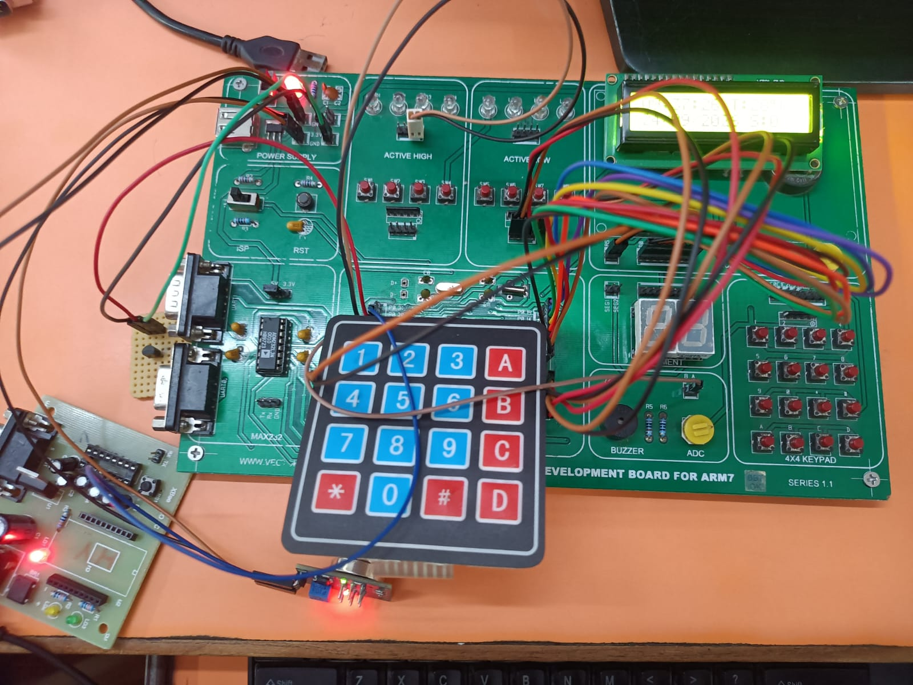
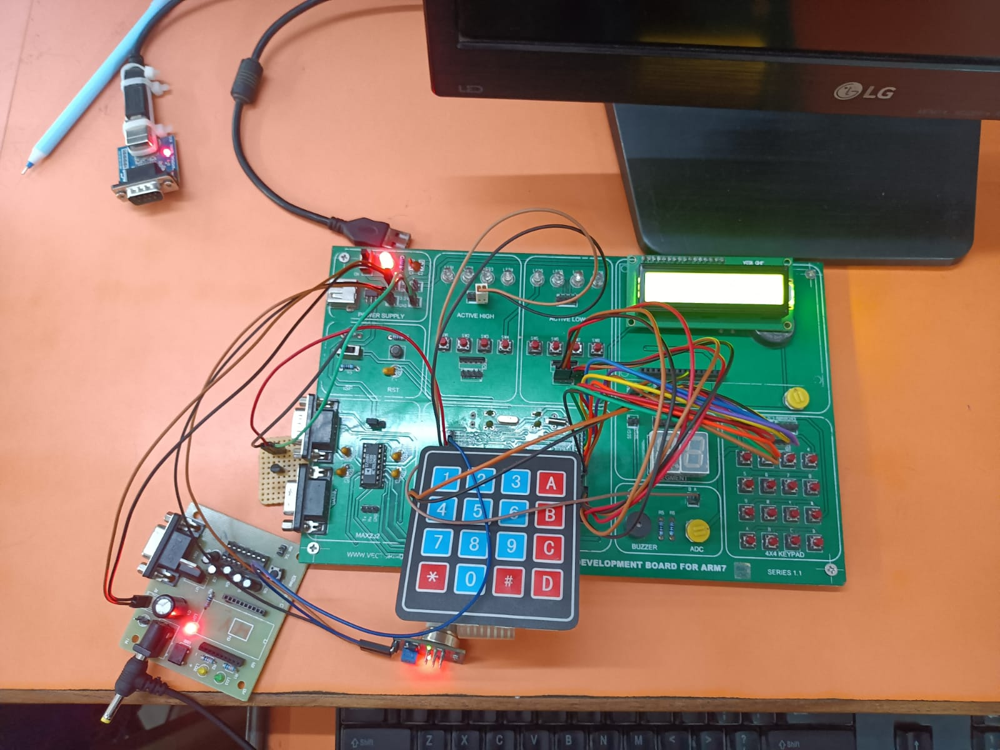

# Kitchen_Safety_Heat_and_Gas_Monitoring_System
The Kitchen Safety Heat and Gas Monitoring System uses the LPC2148 microcontroller, LM35, and MQ2 sensors to monitor temperature and detect gas leakage. It displays readings and RTC time on an LCD, activates buzzer and LEDs during hazards, records safety events, and provides password-protected settings to modify thresholds and RTC values.

## 1. Project Overview

The **Kitchen Safety Heat and Gas Monitoring System** is an embedded systems project developed using the LPC2148 ARM7 microcontroller. It monitors kitchen temperature and gas levels using the LM35 temperature sensor and MQ-2 gas sensor.

When the measured values exceed predefined thresholds, the system provides safety alerts using an LED, buzzer, and LCD display.

The system also includes a Real-Time Clock (RTC) for date and time display, a keypad for user interaction, password-protected settings, and an external interrupt for entering edit mode.

## 2. Objectives

* Monitor kitchen temperature in real time.
* Detect gas leakage or increased gas levels.
* Display sensor readings, date, and time on a 16×2 LCD.
* Generate alerts when configured safety thresholds are exceeded.
* Allow users to configure temperature and gas thresholds.
* Provide password-protected access to settings.
* Improve kitchen safety through embedded monitoring and alert mechanisms.

## 3. Hardware Components

* LPC2148 ARM7 microcontroller
* LM35 temperature sensor
* MQ-2 gas sensor
* 16×2 LCD display
* 4×4 matrix keypad
* Real-Time Clock (RTC)
* LED indicator
* Buzzer
* Switches
* Connecting wires
* Power supply

## 3. Block diagram

## 4. Software and Tools

* Embedded C
* Keil µVision IDE
* Proteus Design Suite
* LPC2148 microcontroller header and peripheral libraries

## 5. Hardware Pin Connections

| Component            | LPC2148 Pin   | Function                   |
| -------------------- | ------------- | -------------------------- |
| LCD Data Bus         | P0.8–P0.15    | 8-bit data                 |
| LCD RS               | P0.16         | Register Select            |
| LCD RW               | P0.17         | Read/Write control         |
| LCD EN               | P0.18         | Enable control             |
| LM35 Output          | P0.28 / AD0.1 | Analog temperature input   |
| MQ-2 Output          | P0.29 / AD0.2 | Analog gas sensor input    |
| Edit Mode Switch     | P0.1 / EINT0  | External interrupt request |
| Alert Silence Switch | P0.24         | Alert silencing input      |
| Keypad Rows          | P1.16–P1.19   | Row connections            |
| Keypad Columns       | P1.20–P1.23   | Column connections         |
| LED Indicator        | P0.23         | Safety alert indication    |
| Buzzer               | P1.27         | Audible alert              |

**Note:** Verify these connections against the final source code and Proteus circuit before hardware implementation.

## 6. Working Principle

1. The LM35 measures the temperature and produces an analog output.
2. The MQ-2 sensor produces an analog signal corresponding to changes in gas concentration.
3. The LPC2148 ADC converts the analog sensor signals into digital values.
4. The microcontroller compares the readings with the configured temperature and gas thresholds.
5. The LCD displays system information, sensor readings, and RTC date and time.
6. When a monitored value exceeds its configured threshold, the system activates the corresponding safety alert.
7. The alert silence switch allows the user to silence an active alert according to the program logic.
8. The keypad and external interrupt provide access to password-protected settings.
9. The user can configure temperature and gas thresholds through the editing interface.

## 7. Main Features

* Real-time temperature monitoring
* Gas-level monitoring
* ADC-based sensor interfacing
* 16×2 LCD status display
* RTC-based date and time display
* LED and buzzer safety alerts
* Keypad-based user interaction
* Password-protected settings
* Configurable temperature and gas thresholds
* External interrupt-based edit-mode request

## 8. How to Run the Project

1. Clone or download this repository.
2. Open the project in Keil µVision or the IDE configured for the LPC2148.
3. Add the required source files and header files to the project.
4. Configure the microcontroller clock and peripheral settings.
5. Verify the ADC channel selection for the LM35 and MQ-2 sensors.
6. Check the LCD, keypad, RTC, LED, buzzer, and switch connections.
7. Compile the program and resolve any errors.
8. Load the generated program into the microcontroller or simulate the circuit in Proteus.
9. Power on the system and test the sensor readings and alert behavior.

## 9. Expected Output

* The LCD displays a startup message when the system powers on.
* Temperature and gas readings are monitored.
* The RTC provides date and time information.
* The LCD displays system status and sensor readings.
* The LED and buzzer provide alerts when configured thresholds are exceeded.
* Password authentication controls access to the configuration menu.

Actual output depends on sensor calibration, circuit wiring, and the final firmware implementation.
## 10.Testing and Result

## 10. Future Enhancements

* Add Wi-Fi or GSM-based mobile notifications.
* Develop a mobile application for remote monitoring.
* Improve gas-sensor calibration and measurement reliability.
* Add an automatic gas shutoff mechanism using a suitable relay and certified valve.
* Store sensor readings for future analysis.
* Add data logging and alert history.

## 11. Project Domain

**Embedded Systems | Embedded C | ARM7 | LPC2148 | ADC | Sensors | RTC | GPIO | Interrupts | Safety Monitoring**

## 12. Applications

* Kitchen safety monitoring
* Gas leakage alert systems
* Temperature monitoring
* Embedded safety and alarm applications

## 13. Author

**ANGOTHU YAKUB PAWAR**

* **Project:** Kitchen Safety Heat and Gas Monitoring System
* **Microcontroller:** LPC2148 ARM7
* **Programming Language:** Embedded C

## 14. Disclaimer

This project is intended for educational and demonstration purposes. It must not be used as the sole protection against gas leaks, fire, or other kitchen hazards. Use certified gas detectors and appropriate safety equipment for real-world applications.

## 15. License

This project is shared for educational and learning purposes. Add an appropriate open-source license if you want to specify the terms under which others may use, modify, or distribute the code.
